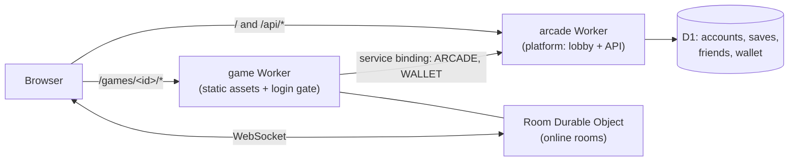

<div align="center">

# Arcade

**A self-hosted mini-game arcade on Cloudflare Workers — one lobby, one account, many games.**

A lobby with accounts, cloud saves, friends, leaderboards and a play-chip wallet, plus a growing set of
browser games (a stock-market roguelike, Guandan, Texas Hold'em, Sichuan mahjong) that you can play
solo against the computer or in private rooms with friends.

[](https://github.com/yyyu-star/arcade/actions/workflows/check.yml)
[](LICENSE)


[](https://deploy.workers.cloudflare.com/?url=https://github.com/yyyu-star/arcade/tree/main/platform)

**English** · [简体中文](README.zh-CN.md)

[Quick start](#quick-start) · [Deploy](#deploy) · [Architecture](#architecture) · [Documentation](#documentation) · [Contributing](CONTRIBUTING.md)

</div>

| 开盘 · Kaipan | 掼蛋 · Guandan | 德州 · Texas Hold'em | 雀馆 · Mahjong |
|:---:|:---:|:---:|:---:|
|  |  |  |  |
| Stock-market roguelike driven by real historical price data | Full-rules competitive Guandan, 4 players | No-limit Hold'em, 2–9 seats | Sichuan "bloody" mahjong engine |

> The games' user interface is in Simplified Chinese. Chips are play money only: they cannot be bought, sold, exchanged or transferred.

## Features

- **One account for every game** — username + password + recovery code, invite-only by default with an admin switch for open registration.
- **Cloud saves, friends, leaderboards and match history** shared by all games through the platform's `/api`.
- **Play-chip wallet** — one wallet across games, "fun" and "stake" modes, daily relief, server-side settlement for online rooms.
- **Private online rooms** built on Durable Objects (WebSocket hibernation, a single alarm per room, the server never sends anyone's hidden cards).
- **Solo play against computer opponents** that runs entirely in the browser — no server cost per hand.
- **Mobile-first** — tested on low-memory iPhones and iPads: capped render scale, visual-viewport sizing, safe areas, WebGL context loss recovery.
- **Deterministic rules cores** — every game's rules are pure functions with seeded RNGs, so saves, replays and bug reports are reproducible.
- **Modules you can split** — the platform, each game and the shared kit are independent modules with their own dependencies, tests, Worker and deploy workflow.

## Games

| Module | Game | Highlights |
|---|---|---|
| [`games/kaipan`](games/kaipan/) | **开盘 Kaipan** | Roguelike about a retail investor; 135 real price segments (public-domain data) drive the market; daily challenge and posters. |
| [`games/guandan`](games/guandan/) | **掼蛋 Guandan** | Complete competitive rules, solo vs. three computer players, private rooms, per-hand review. |
| [`games/texas`](games/texas/) | **德州扑克 Texas Hold'em** | No-limit, 2–9 players, computer personalities, private rooms, stickers and props. |
| [`games/mahjong`](games/mahjong/) | **雀馆 Mahjong** | One engine for many variants; Sichuan "bloody" rules first; ready-hand hints, private rooms. |

## Quick start

Requirements: **Node.js 22** (see `.nvmrc`) and npm. Every module is installed and run on its own — there is no root `package.json`.

```bash
git clone https://github.com/yyyu-star/arcade.git
cd arcade/platform          # or games/kaipan, games/guandan, games/texas, games/mahjong
npm ci
npm run dev                 # local dev server
npm test                    # unit tests (vitest) and Worker tests
npm run build               # production build
```

| Module | Dev port | Preview port |
|---|---|---|
| platform | 5180 (API: `npm run dev:api` on 5181) | 4180 |
| games/kaipan | 5173 | 4173 |
| games/guandan | 5174 | 4174 |
| games/texas | 5175 | 4175 |
| games/mahjong | 5176 | 4176 |

Each module's README explains its own scripts, test tools and smoke tests.

## Deploy

Everything runs on **one hostname**: the platform Worker serves `/` and `/api/*`, and each game Worker is mounted on
`/games/<id>/*` with a path route. Sharing one hostname lets every game reuse the platform's login cookie and `/api`
without CORS. You need a Cloudflare account with a zone (domain) for that hostname.

### Option 1 — Deploy to Cloudflare button

1. **Platform first.** Click the button above. It copies `platform/` into a new repository in your GitHub account,
   creates the D1 database, runs the migrations and deploys the `arcade` Worker. Fill in the secrets it asks for
   (described in [`platform/.dev.vars.example`](platform/.dev.vars.example)).
2. In the Cloudflare dashboard, add a **custom domain** to the `arcade` Worker (for example `games.example.com`).
3. **Kaipan** can also be deployed with a button — see [`games/kaipan`](games/kaipan/). Add the routes
   `<your-host>/games/kaipan` and `<your-host>/games/kaipan/*` to it afterwards.
4. Guandan, Texas Hold'em and Mahjong depend on the shared [`packages/arcade-kit`](packages/arcade-kit/), which the
   button cannot copy along; deploy them with option 2.

### Option 2 — Fork and deploy with GitHub Actions

This is how the repository itself is deployed. Each module has a workflow in `.github/workflows/` that tests on every
pull request and deploys on `main`.

1. Fork the repository and create an environment named **`production`** (Settings → Environments), restricted to `main`.
   In your fork, set `TRUSTED_BASE` in [`tools/verify-main.sh`](tools/verify-main.sh) to the commit you forked from —
   the deploy guard only trusts pull requests merged by the repository owner after that point.
2. Add these environment secrets:

   | Secret | Used by | Value |
   |---|---|---|
   | `CLOUDFLARE_API_TOKEN` | all | API token with Workers Scripts, Workers Routes, D1 and Durable Objects edit rights |
   | `CLOUDFLARE_ACCOUNT_ID` | all | your account ID |
   | `SITE_HOST` | all | the hostname to serve on, without scheme, e.g. `games.example.com` |
   | `D1_DATABASE_ID` | platform | ID of the D1 database created with `npx wrangler d1 create arcade` |

3. Set the platform's own Worker secrets once with `npx wrangler secret put <NAME>` (list in `platform/.dev.vars.example`).
4. Run the workflows — **platform first** (the games bind to its `arcade` Worker), then the games.
   Routes and the site origin are injected at deploy time from `SITE_HOST`; nothing in the repository names a domain.

Deploys only run for commits that reached `main` through a merged pull request (`tools/verify-main.sh`).

## Architecture



| Path | Contents |
|---|---|
| [`platform/`](platform/) | Lobby (React) and `/api` Worker: accounts, cloud saves, friends, leaderboards, wallet, admin |
| [`games/<id>/`](games/) | One game per directory, each with its own Worker, tests, `CHANGELOG.md` and deploy workflow |
| [`packages/arcade-kit/`](packages/arcade-kit/) | Shared kit: room base class, room entry points, browser client, protocol, metering, emotes |
| [`docs/`](docs/) | Cross-module design (in Chinese) |
| [`tools/`](tools/) | Repository tooling: isolation check, module split, git hooks, deploy guard |

Hard rules, enforced by `node tools/check-isolation.mjs` in CI:

- each module carries all of its own files and dependencies, and never references files outside its directory
  (except the shared packages via `file:../../packages/<name>`);
- modules talk only through public interfaces (same-origin HTTP, service bindings);
- browser storage keys are prefixed with the module id (`kaipan.`, `texas.`, …) because everything shares one origin;
- any module can be split into its own repository with `tools/split-module.sh`.

## Documentation

Detailed documentation is written in Chinese.

- [AGENTS.md](AGENTS.md) — repository conventions for humans and AI coding agents (module independence, code style, mobile rules, testing)
- [docs/project.md](docs/project.md) — what the project is, who it is for, principles and roadmap
- [docs/architecture.md](docs/architecture.md) — overall architecture
- [docs/platform-backend.md](docs/platform-backend.md) — accounts, online rooms, quotas and circuit breakers
- [docs/economy.md](docs/economy.md) — the chip economy
- Module READMEs: [platform](platform/README.md) · [kaipan](games/kaipan/README.md) · [guandan](games/guandan/README.md) · [texas](games/texas/README.md) · [mahjong](games/mahjong/README.md) · [arcade-kit](packages/arcade-kit/README.md)

## Contributing

Contributions are welcome — please read [CONTRIBUTING.md](CONTRIBUTING.md) and the [Code of Conduct](CODE_OF_CONDUCT.md).
Security issues: see [SECURITY.md](SECURITY.md).

## License

[MIT](LICENSE). Game assets are generated by the project's own code or come from sources whose licenses allow
commercial use; see each module's asset notes. Kaipan's market data comes from the public-domain WIKI Prices dataset.
