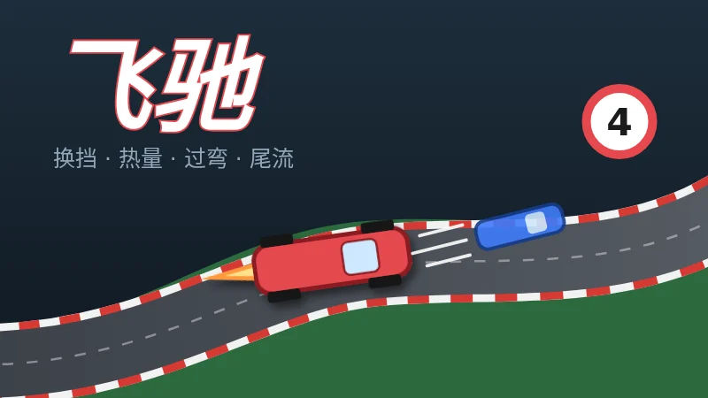
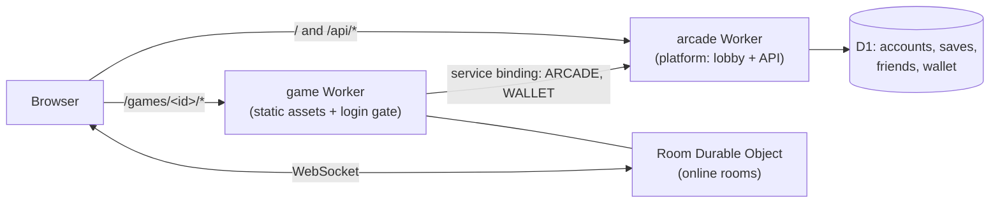

<div align="center">

# Arcade

**A mini-game arcade you host yourself — on Cloudflare Workers or on your own server — with one lobby, one account, many games.**

A lobby with accounts, cloud saves, friends, leaderboards and a play-chip wallet, plus a growing set of
browser games (a stock-market roguelike, a card hall with Guandan and Dou Dizhu, Texas Hold'em, a mahjong hall with Sichuan and Riichi rules, a survivors-like action game, turn-based card racing, a turn-based artillery game)
that you can play solo against the computer or in private rooms with friends. It runs on Cloudflare Workers, or on your own machine with the self-hosting kit.

[](https://github.com/yyyu-star/arcade/actions/workflows/check.yml)
[](LICENSE)


[](https://deploy.workers.cloudflare.com/?url=https://github.com/yyyu-star/arcade/tree/main/platform)

**English** · [简体中文](README.zh-CN.md)

[Quick start](#quick-start) · [Deploy](#deploy) · [Architecture](#architecture) · [Documentation](#documentation) · [Contributing](CONTRIBUTING.md)

</div>

| 开盘 · Kaipan | 牌馆 · Card Hall | 德州 · Texas Hold'em | 雀馆 · Mahjong | 夜巡 · Night Patrol | 飞驰 · Racing |
|:---:|:---:|:---:|:---:|:---:|:---:|
|  |  |  |  |  |  |
| Stock-market roguelike driven by real historical price data | Guandan (4 players) and Dou Dizhu (3 players) | No-limit Hold'em, 2–9 seats | Sichuan "bloody" and Riichi mahjong | Survivors-like action, Vigil and Night Raid modes | Turn-based card racing, 2–6 cars |

> There is no public demo hosted from this repository: run it locally (see [Quick start](#quick-start)) or deploy your own copy (see [Deploy](#deploy)).
> The games' user interface is in Simplified Chinese. Chips are play money only: they cannot be bought, sold, exchanged or transferred.

## Features

- **One account for every game** — username + password + recovery code, invite-only by default with an admin switch for open registration.
- **Cloud saves, friends, leaderboards and match history** shared by all games through the platform's `/api`.
- **Play-chip wallet** — one wallet across games, "fun" and "stake" modes, daily relief, server-side settlement for online rooms.
- **Private online rooms** built on Durable Objects (WebSocket hibernation, a single alarm per room, the server never sends anyone's hidden cards).
- **Solo play against computer opponents** that runs entirely in the browser — no server cost per hand.
- **Mobile-first** — tested on low-memory iPhones and iPads: capped render scale, visual-viewport sizing, safe areas, WebGL context loss recovery.
- **Deterministic rules cores** — every game's rules are pure functions with seeded RNGs, so saves, replays and bug reports are reproducible.
- **Modules you can split** — the platform, each game and the shared packages are independent modules with their own dependencies, tests, Worker and deploy workflow.
- **Two ways to run it** — on Cloudflare Workers, or on your own machine with a bare `workerd` binary or Docker (SQLite or PostgreSQL); the module code is the same.

## Games

| Module | Game | Highlights |
|---|---|---|
| [`games/kaipan`](games/kaipan/) | **开盘 Kaipan** | Roguelike about a retail investor; 135 real price segments (public-domain data) drive the market; daily challenge and posters. |
| [`games/guandan`](games/guandan/) | **牌馆 Card Hall** | Two games on one card table: Guandan with complete competitive rules and per-hand review, and classic Dou Dizhu (bid 1–3, bombs and spring double the stake); solo vs. computer players, private rooms, quick match. Layering in its `docs/doudizhu.md`. |
| [`games/texas`](games/texas/) | **德州扑克 Texas Hold'em** | No-limit, 2–9 players, computer personalities, private rooms, stickers and props. |
| [`games/mahjong`](games/mahjong/) | **雀馆 Mahjong** | One engine for many variants; Sichuan "bloody" rules and Riichi (Tenhou-style hanchan or tonpuu, `docs/riichi.md`); ready-hand hints, private rooms, quick match. |
| [`games/yexun`](games/yexun/) | **夜巡 Night Patrol** | Survivors-like action: steer a young Taoist through a snowy old town; Vigil (survive until dawn) and Night Raid (loot and extract) modes; deterministic fixed-tick simulation, daily challenge. |
| [`games/racing`](games/racing/) | **飞驰 Racing** | Turn-based card racing (shift gears, manage heat, brake for corners, slipstream); three tracks, computer drivers, private rooms. Contributed by a community member; play-for-fun only, no wallet. |
| [`games/danli`](games/danli/) | **弹里个弹 Danli** | Turn-based artillery with pets and kitchen gear: destructible dough terrain, wind, climbing on a stamina budget, fall off the page and you are out. Solo 1-vs-1 against the computer for now. Contributed by a community member; play-for-fun only, no wallet. |

Current versions and what is in progress: see each module's `package.json` and `CHANGELOG.md`.

## Quick start

Requirements: **Node.js 22** (see `.nvmrc`) and npm. Every module is installed and run on its own — there is no root `package.json`.

```bash
git clone https://github.com/yyyu-star/arcade.git
cd arcade/platform          # or games/kaipan, games/guandan, games/texas, games/mahjong, games/racing, games/yexun, games/danli
npm ci
npm run dev                 # local dev server
npm test                    # unit tests (vitest) and Worker tests
npm run build               # production build
```

| Module | Dev port | Preview port |
|---|---|---|
| platform | 5180 (API: `npm run dev:api` on 5181) | 4180 |
| games/kaipan | 5173 | 4173 |
| games/guandan | 5174 | 4174 |
| games/texas | 5175 | 4175 |
| games/mahjong | 5176 | 4176 |
| games/racing | 5177 | 4177 |
| games/yexun | 5178 | 4178 |
| games/danli | 5179 | 4179 |

Packages (`packages/arcade-kit`, `packages/arcade-host`) have no dev server, only tests. Each module's README explains its own scripts, test tools and smoke tests. Before opening a pull request, also run `node tools/check-isolation.mjs` at the repository root (needs no install).

## Deploy

There are two ways to deploy: the **whole site** (platform + games, with accounts, wallet and leaderboards), or **just one game**
on its own. Every game's `wrangler.jsonc` is a standalone config, so a game deploys without the platform; when the whole site is
deployed, the maintainer-owned deployer adds the platform bindings on top.

### Whole site (platform + games)

Everything runs on **one hostname**: the platform Worker serves `/` and `/api/*`, and each game Worker is mounted on
`/games/<id>/*` with a path route. Sharing one hostname lets every game reuse the platform's login cookie and `/api`
without CORS. You need a Cloudflare account with a zone (domain) for that hostname. This is how the repository itself is
deployed: each module has a workflow in `.github/workflows/` that tests on every pull request and deploys on `main`.

1. Fork the repository and create an environment named **`production`** (Settings → Environments), restricted to `main`.
   In your fork, set `TRUSTED_BASE` in [`tools/verify-main.sh`](tools/verify-main.sh) to the commit you forked from —
   the deploy guard only trusts pull requests merged by the repository owner after that point.
2. Add these environment secrets:

   | Secret | Used by | Value |
   |---|---|---|
   | `CLOUDFLARE_API_TOKEN` | all | API token with Workers Scripts, Workers Routes, D1 and Durable Objects edit rights |
   | `CLOUDFLARE_ACCOUNT_ID` | all | your account ID |
   | `SITE_HOST` | all | the hostname to serve on, without scheme, e.g. `games.example.com` |
   | `D1_DATABASE_ID` | platform | ID of the D1 database created with `npx wrangler d1 create arcade` |

3. Set the platform's own Worker secrets once with `npx wrangler secret put <NAME>` (list in `platform/.dev.vars.example`).
4. Run the workflows — **platform first** (the games bind to its `arcade` Worker), then the games.
   [`tools/workers.json`](tools/workers.json) declares which games connect to the platform; for those, `tools/deployer/deploy.mjs`
   adds the `ARCADE` (login) and `WALLET` (wallet) service bindings, sets `GATE` to `"login"` and turns off `workers.dev`.
   Routes and the site origin are injected from `SITE_HOST`; nothing in the repository names a domain.

Deploys only run for commits that reached `main` through a merged pull request (`tools/verify-main.sh`).
The button at the top deploys the platform alone (it creates the D1 database and asks for the secrets in
[`platform/.dev.vars.example`](platform/.dev.vars.example)); games deployed with their own buttons are not connected to it.

### Just one game

No platform, no domain needed — the game gets a `https://<id>.<your-subdomain>.workers.dev` address.

- **Deploy to Cloudflare button**: `https://deploy.workers.cloudflare.com/?url=https://github.com/yyyu-star/arcade/tree/main/games/<id>`
  (replace `<id>` with `kaipan`, `guandan`, `texas`, `mahjong`, `racing`, `yexun` or `danli`). The button copies only that game's directory, so it needs the game to depend on the published `@yyyu-star/arcade-kit` from npm
  (aliased, see the `arcade-kit` line in each game's `package.json`) instead of the in-repo copy; each game's README says whether its button is ready.
- **From a fork**: `cd games/<id> && npm ci && npx wrangler login && npm run deploy`.

A standalone game has single-player against the computer, friend rooms (players are identified by a guest cookie and pick a
nickname with `?name=`) and local saves. It has no login, cloud saves, leaderboards or wallet. Details:
[docs/new-game.md](docs/new-game.md) section 7.

### Self-hosting (no Cloudflare)

The whole site (platform + all games) also runs on your own machine as **one process**: [`packages/arcade-host`](packages/arcade-host/README.md)
runs the unmodified modules in [workerd](https://github.com/cloudflare/workerd) and supplies what Cloudflare normally provides
(D1 on SQLite or PostgreSQL, static assets, routing, cron triggers). The Cloudflare deployment is unaffected.
A ready-made multi-arch image (amd64, arm64) is published from `main` as **`ghcr.io/yyyu-star/arcade`**
(tags: `latest`, the release version, the commit short hash). The image contains no secrets, hostnames or database IDs — everything comes from environment variables.

**Settings** (environment variables; put them in a `secrets.env` file):

| Variable | Required | What |
|---|---|---|
| `PEPPER_PW`, `PEPPER_RC`, `PEPPER_SID`, `PEPPER_IP` | yes | hashing peppers, format `k1:<random>`; never change or lose them once in use |
| `ADMIN_TOKEN` | to create the first admin | same format |
| `SITE_ORIGIN` | behind HTTPS (compose, Caddy) | the public origin, e.g. `https://game.example.com`; without it logins fail behind a TLS proxy |
| `ARCADE_DB` | no | `sqlite` (default) or `pg` |
| `ARCADE_PG_URL` | with `ARCADE_DB=pg` | PostgreSQL connection string |

Generate the secrets once (keep a copy of the file somewhere safe, apart from backups):

```sh
mkdir arcade && cd arcade
for k in PEPPER_PW PEPPER_RC PEPPER_SID PEPPER_IP ADMIN_TOKEN; do echo "$k=k1:$(openssl rand -hex 24)"; done > secrets.env
chmod 600 secrets.env
```

**Try it — one container, SQLite, data in a volume:**

```sh
docker run -d --name arcade --restart unless-stopped -p 127.0.0.1:8787:8787 -v arcade-data:/data --env-file secrets.env ghcr.io/yyyu-star/arcade:latest
docker exec arcade /app/ops/create-admin.sh zhanzhang 站长   # prints the first admin's password and recovery code once
```

Open <http://localhost:8787> and log in; registration is closed until you open it (or create accounts) in `/admin`.
For a public site put HTTPS in front — the compose setup below does that.

**Production — docker compose with automatic HTTPS (Caddy):** [`compose.yaml`](tools/selfhost/docker/compose.yaml) runs `arcade` (not published to the host),
`caddy` (ports 80/443, gets and renews the certificate for `SITE_HOST`, passes the real client IP) and, with the `pg` profile, `postgres`.
Point the domain's DNS at the server first. In the same directory as `secrets.env`:

```sh
curl -fsSLO https://raw.githubusercontent.com/yyyu-star/arcade/main/tools/selfhost/docker/compose.yaml
curl -fsSLO https://raw.githubusercontent.com/yyyu-star/arcade/main/tools/selfhost/docker/Caddyfile
echo "SITE_ORIGIN=https://game.example.com" >> secrets.env
echo "SITE_HOST=game.example.com" > .env
docker compose up -d
docker compose exec arcade /app/ops/create-admin.sh zhanzhang 站长
```

PostgreSQL instead of SQLite (the platform database goes into the bundled `postgres` service; game rooms stay in the `arcade-data` volume) — do this before the first start:

```sh
openssl rand -hex 24 > pg_password.txt
echo "ARCADE_PG_URL=postgres://arcade:$(cat pg_password.txt)@postgres:5432/arcade" >> secrets.env
printf 'ARCADE_DB=pg\nCOMPOSE_PROFILES=pg\n' >> .env
docker compose up -d
```

**Backup and restore** (SQLite: logical export through the internal admin endpoint, which only listens inside the container):

```sh
docker compose exec arcade /app/ops/backup.sh /data/backups
docker compose cp arcade:/data/backups ./backups                      # copy off the server from here
docker compose exec arcade sh -c '/app/ops/restore.sh d1-arcade-DB "$(ls -d /data/backups/*/ | tail -1)d1-arcade-DB.sql"'   # restore the latest
```

With PostgreSQL: `docker compose exec postgres pg_dump -U arcade --clean --if-exists arcade > arcade.sql` and
`docker compose exec -T postgres psql -U arcade -d arcade < arcade.sql`.

**Upgrade and roll back** (migrations only add, so an older image still works with the newer database):

```sh
docker tag ghcr.io/yyyu-star/arcade:latest arcade:previous     # keep the running version
docker compose pull && docker compose up -d                     # upgrade
echo "ARCADE_IMAGE=arcade:previous" >> .env && docker compose up -d   # roll back (remove the line again to follow latest)
```

**Without Docker — binary + systemd** (Debian/Ubuntu; Node 22 is needed only to build): build a release tarball from source, install it,
and put Caddy in front.

```sh
git clone https://github.com/yyyu-star/arcade.git && cd arcade
npm ci --ignore-scripts --prefix tools/deployer
(cd packages/arcade-host && npm ci && npm run build)
v=$(git rev-parse --short HEAD)
tools/selfhost/pack-all.sh build/art && ARCADE_VERSION=$v tools/selfhost/release.sh build/art build/out --with-pg
sudo build/out/arcade-$v/ops/install.sh build/out/arcade-$v.tar.gz game.example.com   # user, dirs, secrets in /etc/arcade/secrets.env, systemd unit
sudo /opt/arcade/current/ops/create-admin.sh zhanzhang 站长
sudo apt install caddy && sudo cp /opt/arcade/current/ops/Caddyfile /etc/caddy/Caddyfile
echo "SITE_HOST=game.example.com" | sudo tee /etc/default/caddy && sudo systemctl restart caddy
```

Backup: `sudo /opt/arcade/current/ops/backup.sh /var/lib/arcade/backups` (nightly via cron or a systemd timer). Upgrade: pull, rebuild as above, then
`sudo /opt/arcade/current/ops/upgrade.sh build/out/arcade-$v.tar.gz` (backs up first, switches back automatically if the new version does not come up);
roll back: `sudo /opt/arcade/current/ops/rollback.sh`. PostgreSQL: add the two lines `ARCADE_DB=pg` and `ARCADE_PG_URL` (your connection string) to `/etc/arcade/secrets.env`.

Not verified on a real server yet: Caddy getting a real certificate for a public domain, and the systemd unit and install/upgrade scripts.
CI tests the published image (SQLite and PostgreSQL), the full compose setup through Caddy on `localhost` (Caddy's internal certificate), and the binary.
Keeping game rooms in PostgreSQL too (nothing on disk) needs every game with rooms on arcade-kit ≥ 0.21.0, which is not the case yet.
Details, all options and the CI coverage: [tools/selfhost/README.md](tools/selfhost/README.md).

## Architecture



| Path | Contents |
|---|---|
| [`platform/`](platform/) | Lobby (React) and `/api` Worker: accounts, cloud saves, friends, leaderboards, wallet, admin |
| [`games/<id>/`](games/) | One game per directory, each with its own Worker, tests, `CHANGELOG.md` and deploy workflow |
| [`packages/arcade-kit/`](packages/arcade-kit/) | Shared kit, published to npm as `@yyyu-star/arcade-kit`: room base class, room entry points, browser client, protocol, metering, table interaction, chat, share cards, social widgets |
| [`packages/arcade-host/`](packages/arcade-host/) | Self-hosting runtime on workerd (see above); tested, not deployed to Cloudflare |
| [`docs/`](docs/) | Cross-module design (in Chinese) |
| [`tools/`](tools/) | Repository tooling: isolation and deploy-config checks, the pinned deployer, module split, git hooks, deploy guard, [self-hosting scripts](tools/selfhost/README.md) |

Hard rules, enforced by `node tools/check-isolation.mjs` in CI:

- each module carries all of its own files and dependencies, and never references files outside its directory
  (except the shared packages via `file:../../packages/<name>`);
- modules talk only through public interfaces (same-origin HTTP, service bindings);
- browser storage keys are prefixed with the module id (`kaipan.`, `texas.`, …) because everything shares one origin;
- any module can be split into its own repository with `tools/split-module.sh`.

## Documentation

Detailed documentation is written in Chinese.

- [AGENTS.md](AGENTS.md) — repository conventions for humans and AI coding agents (module independence, code style, mobile rules, testing)
- [docs/project.md](docs/project.md) — what the project is, who it is for, principles and roadmap
- [docs/architecture.md](docs/architecture.md) — overall architecture
- [docs/platform-backend.md](docs/platform-backend.md) — accounts, online rooms, quotas and circuit breakers
- [docs/economy.md](docs/economy.md) — the chip economy
- [docs/social.md](docs/social.md) — sharing, presence, invitations, spectating, friends' boards
- [docs/balance.md](docs/balance.md) — difficulty and payout targets shared by all games
- [docs/table-fun.md](docs/table-fun.md) — the shared table-interaction spec (emotes, props, computer reactions)
- [docs/new-game.md](docs/new-game.md) — how to add a new game
- [docs/review-policy.md](docs/review-policy.md) — how pull requests are reviewed and merged (automated pre-review; only maintainers merge and approve deploys)
- Module READMEs: [platform](platform/README.md) · [kaipan](games/kaipan/README.md) · [guandan](games/guandan/README.md) · [texas](games/texas/README.md) · [mahjong](games/mahjong/README.md) · [yexun](games/yexun/README.md) · [racing](games/racing/README.md) · [danli](games/danli/README.md) · [arcade-kit](packages/arcade-kit/README.md) · [arcade-host](packages/arcade-host/README.md) · [selfhost](tools/selfhost/README.md)

## Contributing

Contributions are welcome — please read [CONTRIBUTING.md](CONTRIBUTING.md) and the [Code of Conduct](CODE_OF_CONDUCT.md).
Security issues: see [SECURITY.md](SECURITY.md).

## License

[MIT](LICENSE). Game assets are generated by the project's own code or come from sources whose licenses allow
commercial use; see each module's asset notes. Kaipan's market data comes from the public-domain WIKI Prices dataset.
