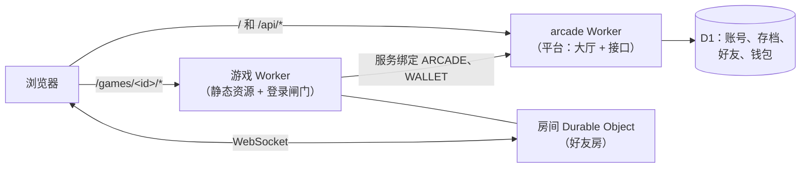

<div align="center">

# Arcade 小游戏街机厅

**部署在 Cloudflare Workers 上的自托管小游戏平台：一个大厅、一个账号，玩所有游戏。**

大厅带账号、云存档、好友、排行榜和娱乐筹码钱包；游戏有股市肉鸽《开盘》、掼蛋、德州扑克、川麻《雀馆》，
可以单机对电脑，也可以开好友房一起玩。

[](https://github.com/yyyu-star/arcade/actions/workflows/check.yml)
[](LICENSE)


[](https://deploy.workers.cloudflare.com/?url=https://github.com/yyyu-star/arcade/tree/main/platform)

[English](README.md) · **简体中文**

[快速开始](#快速开始) · [部署](#部署) · [架构](#架构) · [文档](#文档) · [参与贡献](CONTRIBUTING.md)

</div>

| 开盘 | 掼蛋 | 德州扑克 | 雀馆 |
|:---:|:---:|:---:|:---:|
|  |  |  |  |
| 真实历史行情驱动的散户肉鸽 | 规则完整的竞赛掼蛋 | 无限注德州，2–9 人 | 川麻·血战到底 |

> 筹码只是游戏里的分数：不能买、不能卖、不能兑换、不能转让，没有任何现金价值。

## 特点

- **一个账号玩所有游戏**：用户名 + 密码 + 恢复码；默认邀请制，管理员可以随时开关注册。
- **云存档、好友、排行榜、战绩**：平台的 `/api` 统一提供，所有游戏共用。
- **娱乐筹码钱包**：所有游戏一个钱包，分娱乐和实盘；每天有补给；好友房由服务端结算。
- **好友房**：基于 Durable Objects（WebSocket 休眠、每个房间只用一个闹钟），服务端说了算，绝不下发别人的底牌。
- **单机对电脑**：整局在浏览器里跑，不花服务器钱。
- **手机优先**：在低内存的 iPhone、iPad 上实测过：渲染倍数封顶、按可见区域算高度、让出刘海、WebGL 上下文丢了能恢复。
- **规则可复现**：每个游戏的规则核心都是纯函数加带种子的随机数，存档、回放、复现 bug 都靠它。
- **模块随时能拆**：平台、每个游戏、共用包都是独立模块，各有依赖、测试、Worker 和部署流程。

## 游戏

| 模块 | 游戏 | 亮点 |
|---|---|---|
| [`games/kaipan`](games/kaipan/) | **开盘** | 散户炒股题材的肉鸽；135 段真实历史走势（公有领域数据）驱动大盘；每日挑战、结局海报。 |
| [`games/guandan`](games/guandan/) | **掼蛋** | 竞赛规则完整；单机对三个电脑；好友房；每副复盘。 |
| [`games/texas`](games/texas/) | **德州扑克** | 无限注，2–9 人；电脑性格各异；好友房；表情和道具。 |
| [`games/mahjong`](games/mahjong/) | **雀馆** | 一套引擎多种玩法，先做川麻·血战到底；听牌提示；好友房。 |

## 快速开始

需要 **Node.js 22**（见 `.nvmrc`）和 npm。每个模块各自安装、各自运行，仓库根没有 `package.json`。

```bash
git clone https://github.com/yyyu-star/arcade.git
cd arcade/platform          # 或 games/kaipan、games/guandan、games/texas、games/mahjong
npm ci
npm run dev                 # 本地开发
npm test                    # 单元测试（vitest）和 Worker 测试
npm run build               # 正式构建
```

| 模块 | 开发端口 | 预览端口 |
|---|---|---|
| platform | 5180（接口 `npm run dev:api`：5181） | 4180 |
| games/kaipan | 5173 | 4173 |
| games/guandan | 5174 | 4174 |
| games/texas | 5175 | 4175 |
| games/mahjong | 5176 | 4176 |

各模块的脚本、测试工具和冒烟测试见模块自己的 README。

## 部署

所有东西挂在**同一个主机名**下：平台 Worker 负责 `/` 和 `/api/*`，每个游戏的 Worker 用路径路由挂在 `/games/<id>/*`。
同一个主机名，游戏就能直接共用平台的登录 cookie 和 `/api`，没有跨域问题。你需要一个 Cloudflare 账号，以及这个主机名所在的域名（zone）。

### 方式一：Deploy to Cloudflare 按钮

1. **先部署平台**：点上面的按钮。它会把 `platform/` 复制成你 GitHub 账号下的新仓库，建好 D1 数据库、跑迁移、部署 `arcade` Worker。
   按提示填好 secret（说明见 [`platform/.dev.vars.example`](platform/.dev.vars.example)）。
2. 在 Cloudflare 控制台给 `arcade` Worker 加一个**自定义域名**（比如 `games.example.com`）。
3. **开盘**也能用按钮部署，见 [`games/kaipan`](games/kaipan/)；部署完给它加路由 `<你的主机名>/games/kaipan` 和 `<你的主机名>/games/kaipan/*`。
4. 掼蛋、德州、麻将依赖共用包 [`packages/arcade-kit`](packages/arcade-kit/)，按钮带不过去，请用方式二。

### 方式二：fork 后用 GitHub Actions 部署

本仓库自己就是这样部署的。每个模块在 `.github/workflows/` 里有一个流程：PR 上只测试，合并进 `main` 后部署。

1. fork 本仓库，新建名为 **`production`** 的环境（Settings → Environments），只允许 `main` 使用。
   在你的 fork 里把 [`tools/verify-main.sh`](tools/verify-main.sh) 的 `TRUSTED_BASE` 改成你 fork 时的那个提交：
   部署前核对只认这之后由仓库所有者合并的 PR。
2. 在这个环境里加 secret：

   | Secret | 谁用 | 值 |
   |---|---|---|
   | `CLOUDFLARE_API_TOKEN` | 全部 | 有 Workers 脚本、Workers 路由、D1、Durable Objects 编辑权限的 API 令牌 |
   | `CLOUDFLARE_ACCOUNT_ID` | 全部 | 你的账号 ID |
   | `SITE_HOST` | 全部 | 要提供服务的主机名，不带协议，比如 `games.example.com` |
   | `D1_DATABASE_ID` | 平台 | 用 `npx wrangler d1 create arcade` 建出来的 D1 数据库 ID |

3. 平台 Worker 自己的 secret 用 `npx wrangler secret put <名字>` 设一次（清单在 `platform/.dev.vars.example`）。
4. 运行部署流程：**先平台**（游戏要绑定它的 `arcade` Worker），再各个游戏。
   路由和站点地址在部署时由 `SITE_HOST` 注入，仓库里不写任何域名。

只有经 PR 合并进 `main` 的提交才会部署（`tools/verify-main.sh` 把关）。

## 架构



| 目录 | 内容 |
|---|---|
| [`platform/`](platform/) | 大厅（React）和 `/api` Worker：账号、云存档、好友、排行榜、钱包、管理页 |
| [`games/<id>/`](games/) | 一个目录一个游戏，各自有 Worker、测试、`CHANGELOG.md` 和部署流程 |
| [`packages/arcade-kit/`](packages/arcade-kit/) | 共用包：房间基类、开房进房入口、浏览器连接器、协议、计量、表情道具 |
| [`docs/`](docs/) | 跨模块的设计文档 |
| [`tools/`](tools/) | 仓库工具：独立性检查、拆分模块、git hooks、部署前核对 |

几条硬约束，CI 里由 `node tools/check-isolation.mjs` 检查：

- 每个模块自带全部文件和依赖，不引用自己目录以外的文件（唯一例外：用 `file:../../packages/<name>` 依赖共用包）；
- 模块之间只走公开接口（同域 HTTP、服务绑定）；
- 浏览器存储的 key 一律加模块前缀（`kaipan.`、`texas.` ……），因为大家同域；
- 任何模块都能用 `tools/split-module.sh` 拆成独立仓库。

## 文档

- [AGENTS.md](AGENTS.md)：仓库规范，给开发者和 AI 编程代理（模块独立、代码规范、手机适配、测试）
- [docs/project.md](docs/project.md)：项目做什么、给谁、守什么底线、路线图
- [docs/architecture.md](docs/architecture.md)：整体架构
- [docs/platform-backend.md](docs/platform-backend.md)：账号、联机房间、额度和熔断
- [docs/economy.md](docs/economy.md)：筹码体系
- [docs/new-game.md](docs/new-game.md)：新游戏开发指南
- [docs/review-policy.md](docs/review-policy.md)：PR 怎么审、怎么合（自动预审，只由维护者合并和批准部署）
- 各模块 README：[平台](platform/README.md) · [开盘](games/kaipan/README.md) · [掼蛋](games/guandan/README.md) · [德州](games/texas/README.md) · [麻将](games/mahjong/README.md) · [arcade-kit](packages/arcade-kit/README.md)

## 参与贡献

欢迎贡献，请先读 [CONTRIBUTING.md](CONTRIBUTING.md) 和[行为准则](CODE_OF_CONDUCT.md)。安全问题见 [SECURITY.md](SECURITY.md)。

## 许可证

[MIT](LICENSE)。游戏素材由项目自己的代码生成，或来自许可明确可商用的来源，见各模块的素材说明；开盘的行情数据来自公有领域的 WIKI Prices 数据集。
