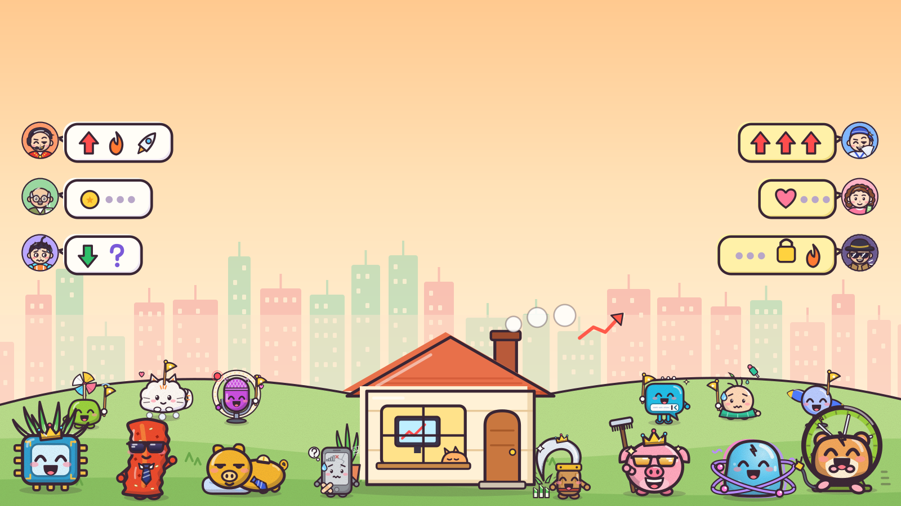

# Kaipan · 开盘

A stock-market roguelike for the browser (Phaser 4 + TypeScript). You are a small-time retail trader: each morning read the
group-chat gossip, pick cartoon "stock buddies" for your holdings, then hit **Open** and watch hot themes rotate, leaders drag their
followers up limit after limit, and your account swing. Pay the bill at the end of every month or the run is over.

- **Real price action, fictional everything else.** Every run replays a random slice of real 1996–2018 US market history (public-domain
  WIKI Prices data), scaled into the game; years, companies and tickers never appear on screen. All stocks, people, news, art and audio
  are original or procedurally generated.
- **Deterministic rules core.** `src/core/` is pure: same seed + same actions = the same run, bit for bit. Saves, replays, the daily
  challenge and bot simulations (`npm run sim`) all rely on it.
- **Modes.** Casual runs (a 5-month short run or a full year, eight difficulty levels), a daily challenge with a leaderboard, friend
  challenges, and a "live" mode that stakes play chips from the Arcade platform wallet. Chips are play money only.
- **Runs standalone.** `wrangler.jsonc` deploys the game on its own as a single Worker; login, cloud saves, leaderboards and chips light up
  only when it is mounted next to the Arcade platform.

```bash
cd games/kaipan && npm ci
npm run dev      # http://localhost:5173
npm test         # vitest: rules, replays, content, workers, architecture checks
npm run build:cf # production build for /games/kaipan/
```

The rest of this README, the in-game text, code comments and design docs (`docs/`) are in Simplified Chinese. License: MIT (`LICENSE`).

---

# 开盘

散户炒股主题的肉鸽游戏：每天看群聊里的小道消息，挑股票放进持仓，开盘后看它们跟着风口轮流火、带头大哥带着小弟涨；
每个月底账户里要留够钱还上一笔，还不上这局就结束。一局是短局 5 个月或完整一年 12 个月，打完看你是韭菜还是股神。
画面一律用大白话，A 股原词（题材、龙头、跟风……）只出现在提示和图鉴的小白词典里。美术和音频全部由程序生成；股票、公司、人物和消息全部虚构。

当前版本见 `package.json`，每版改了什么见 `CHANGELOG.md`。



## 玩什么

- **一天**：开盘前看群聊里群友对风口的看法（头像旁是本局战绩「说对 3/5」），从推荐里买进空格，或者卖掉手里的（今天买的明天才能卖）；
  点「开盘」，风口热度升温冒火、降温结冰，持仓小人跟着涨跌，带头大哥涨停时带着同风口的小弟多涨。收盘有小结卡讲清每只为什么涨跌。
  没什么事的日子（买不了、没人唱反调、没有重磅消息）会自动快进，点一下就停，设置里可以关。
- **一个月**：每月有一个看点（月度主题）和一个小目标；最后一个交易日收盘后还钱，账户不够这局就结束；还上了三选一领奖励，偶尔有事件二选一。
- **行情**：每局从 135 段真实历史走势里随机抽一段（牛市、泡沫、横盘、熊市、崩盘五种市况），大环境、风口和股票小人跟着它走；
  游戏里不说年份和公司，局末用花名讲一篇「这段日子」小故事，图鉴「行情段」页能重看。行情没下载下来时改用模拟行情，照常计分。
- **仓位、押跌、银行**：买的时候选「试一口 / 半仓 / 重仓」，持仓卡上能加仓、减一半、清仓；拿到「押跌许可证」后可以押一只跌（它涨停时会被轧）；
  第 2 个月起能把东西押给银行借钱，账户跌到欠款的 1.45 倍银行打电话，跌到 1.25 倍收走东西。第一次碰到这些玩法时图鉴「小知识」点亮一张卡。
- **人设和难度**：5 个人设（3 个开局可选，2 个靠成就解锁），8 级市场环境逐级叠加约束，通关一级解锁下一级。
- **群友**：各有性格和口头禅，每局状态不一样（这局可能特别准，也可能特别不靠谱）；收盘按局面接话，股票小人也会跟着行情改口（见 `docs/design-0.7-chat.md`）。
- **局外**：每日挑战（按日期固定种子、人设和难度，有排行榜）、好友挑战（同一开局比成绩）、带平台筹码进场的实盘、分享卡；
  图鉴收股票、群友、道具、事件、行情段、小知识、小白词典，成就 45 个（含 4 个隐藏结局），分铜、银、金三档。
- **新手**：第一局有分步教程，在恰好用得上的时候讲群聊、推荐、开盘、风口看板、卖出、大哥带小弟、连续涨停和月底还钱，可以跳过，设置里能重新开启；
  对局右上角「怎么玩」是几页图解。

主页：右下角一张大卡继续上局或快速开始（沿用上次的人设和难度），旁边是每日挑战、实盘、新一局；右上角是怎么玩、图鉴、成就、设置、关于，
左上角常驻「大厅」。对局里的小屋随一天变光：盘前清晨、开盘白天、收盘傍晚、月底入夜。

快捷键：1–3（有道具时到 4）买对应的推荐，Shift+1–5 卖出第 1–5 格，空格或回车开盘、跳过动画、继续，F 快进平淡日；
月底三选一按 1–3、0 都不要；事件按 1 / 2；Esc 取消、关闭对话框。触屏设备上不显示快捷键，点屏幕任意处跳过动画。

设置：主音量、音效、音乐、静音、动画速度（关闭 / 1× / 2× / 4×）、涨跌配色（红涨绿跌 / 绿涨红跌）、减少动态效果、平淡日自动快进、
收盘小结和月底账单的详略，保存在浏览器本地。

### 屏幕

电脑按 1280×720 的世界布局，窗口不是 16:9 时背景往两边或上下铺满。手机横屏和触屏平板用手机布局（世界高 404、宽随屏幕比例 718–960），
比 iPhone SE 还矮的屏幕再抬最小字号和点击区；手机和平板竖着拿时提示「把屏幕横过来」。省内存设备（iOS、触屏）渲染倍数封顶 2。
详细做法见 `docs/mobile.md`。

## 存档和平台

- **存档**：`kaipan.save` 存完整的局面快照和版本号（格式 5），读档直接用快照，小版本调数值后旧存档按当时的局面继续；
  更早格式的存档接不上，读到时清掉并提示开新局。存档损坏时先备份到 `kaipan.save.corrupt`。启动时清掉早年留下的旧 key（`src/platform/storage.ts` 的 `LEGACY_KEYS`）。
- **档案**：`kaipan.profile` 和单局存档分开，记图鉴、成就、解锁和各人设、难度、每日挑战的最好成绩；损坏时备份到 `kaipan.profile.corrupt` 后重建。
- **云存档**（`src/platform/cloud.ts`，同步哪些槽在 `src/view/cloudSync.ts`）：登录后同步档案（槽 `profile`）和教程标记（槽 `tutorial`），
  打到一半的局和设置不同步。元数据在 `kaipan.cloud`，合并前的本地备份在 `kaipan.<槽>.pre-sync`；换账号时上一个账号的本地进度存在
  `kaipan.<槽>.pre-switch.<userId>`，它回来时并回去，并完改名 `.restored`。教程重新开启记一次 `reset`，合并时次数多的一边说了算。
  切回前台、上传前、收到 409 时重新确认账号；多个标签页靠 storage 事件互通。接口见总仓库 `docs/platform-backend.md`。
- **每日排行榜**（交分和读榜 `src/platform/board.ts`，一局的交分状态 `src/view/dailyBoard.ts`）：每日挑战结束交一次分到 `daily-YYYY-MM-DD`
  （北京日期；规则版本 `DAILY_RULES` 大于 0 时加 `-v<n>`），通关分 = 1e11 + 账户元数，没通关 = 还上的月数，显示规则在 `public/daily.json`。
  只有用当天冻结段池（`src/core/content/dailySegments.ts`）里那段真实行情的局才交；段池顺序和数量不能改，要换就加版本。
  429、busy、wrong_user 不重试，连不上给「重试」。读榜按榜和范围缓存 45 秒，交上分时作废。
- **实盘**（设计 `docs/design-live.md`）：规则在开局设置 `RunSetup.live` 和 `src/core/live.ts`（四档对应难度 1/2/3/3，杠杆 1× / 2× / 3×）；
  档位表和结回算法在 `src/core/liveTiers.ts`（Worker 也用）。钱包走浏览器 → 开盘 Worker（同域 `POST api/live/{buyin,settle,refund}`，`src/worker/live.ts`）
  → 服务绑定 `WALLET`；浏览器只给 `ref`、`tier`、`bp`，金额和到期时间由 Worker 定。这台设备上的账在 `kaipan.live`（`src/platform/live.ts`）：
  带入前记 `buying`，结回或放弃先记 `settling` 再发，连不上、busy 都留着重发。结回时带战绩小结（`src/core/career.ts`），称号中文名在 `public/titles.json`。
- **好友挑战**（设计 `docs/design-challenge.md`）：娱乐局打完、登录了，结束页「挑战好友」把种子、开局设置、行情段和版本交给平台拿链接 `?challenge=<id>`；
  好友打开先弹挑战卡，接受就是同一个开局，打完交成绩看名次。挑战局照每日挑战的规矩记档案。
- **分享卡**（设计 `docs/design-share.md`）：结束页「分享」，开盘只交数据，画卡和分享在共用包 `arcade-kit/share`；链接按当前页面推出游戏地址，代码里不写站点地址。
- **社交**：有登录提示时挂共用包 `arcade-kit/social`，报「在玩开盘」、收好友邀请。
- **回大厅**（`src/view/lobby.ts`）：跳平台首页 `/`。主页和结束页左上角的「大厅」直接走；对局里从设置走先确认一次，走之前先补传云存档
  （keepalive 额度记账在 `src/platform/keepalive.ts`）。
- **安全头**（`public/_headers`）：CSP、`frame-ancestors 'self'`、`X-Frame-Options: SAMEORIGIN`；经 Worker 回的首页也带上。用到新来源时同时改这里，`tests/headers.test.ts` 锁底线。
- 未捕获的错误弹独立面板，可以继续、重新载入、放弃存档开新局或复制错误信息；最近 20 条错误记在 `kaipan.errors`。

单独部署（没有平台）时：有完整的单机游戏和本机的每日挑战；没有登录、云存档、排行榜、好友挑战和实盘。页面启动时问一次同域 `/api/me`，
回 404 或不是 JSON 就当没有平台，把这些入口藏起来；实盘接口回 `501 no_wallet`。开盘没有好友房。

## 本地开发

需要 Node 22（见 `.nvmrc`）。在本目录里：

```bash
npm ci
npm run dev          # 开发服务器 0.0.0.0:5173（热更新）
npm run build        # 类型检查 + 正式构建到 dist/（KP_SOURCEMAP=1 时带 sourcemap）
npm run build:cf     # 部署用的构建：产物在 dist-cf/games/kaipan/，适配 /games/kaipan/ 子路径
npm run preview      # 用正式构建启动服务 0.0.0.0:4173
npm test             # 单元测试：规则与回放、内容、机器人、平台层、Worker、音频纯逻辑、架构约束
npm run sim          # 数值模拟（参数见 tools/sim.ts 顶部：--balance 配平表、--live 实盘结回、--gear 杠杆、--set 临时改数值）
npm run shot         # 无头 Chromium 冒烟 + 截图到 shots/（参数见 tools/shot.ts 顶部：--main、--live、--phone、--playtest 等）
npm run audio-check  # 离线渲染所有音效与音乐，检查峰值、响度、时长、拖尾、节点泄漏
node tools/mem-probe.ts  # 按几种手机、平板、电脑的视口和 DPR 估算显存
```

开发和预览服务监听所有网卡，同一局域网里的手机、平板可以直接打开测试（不登录，云存档、排行榜、实盘不可用）。

和平台联调（登录、云存档、排行榜、实盘）：平台目录先 `npm run build` 再 `npm run dev:api`（5181），开盘 `npm run dev` 会把 `/api` 转过去；
先在 http://localhost:5181 登录，再用 http://localhost:5173 打开开盘（`__Host-` cookie 要求安全上下文，用 IP 打开时登录状态带不过来）。

### 调试用 URL 参数

开局参数映射到规则层的开局设置（`RunSetup`，见 `docs/core-api.md`）：`seed`、`account`、`items=a,b`、`friends=a,b`、`themes=a,b,…`（6 个登场题材）、
`holdings=a,b`（开局持仓，须属于登场题材）、`difficulty`（1–8）、`persona`、`daily=1|YYYY-MM-DD`、`ext=1`（打开仓位、押跌、银行）。带调试开局参数的局跳过主页、不计入档案，而且是模拟行情。
其余：`anim=0`、`speed=N`、`debug=1`（调试浮层，显示预先掷好的行情等隐藏信息）、`scale=N`（渲染倍数）、`soundboard=1`（音频试听）、
`atlas=0|1`、`layout=phone|desktop`（强制布局）、`market=synthetic|<段 id>`（从界面开的局用模拟行情或指定一段，id 查 `tools/data/segments-manifest.json`）。
开发版和 `debug=1` 时挂出 `window.__game` 调试接口（`src/debug/bridge.ts`：`controls()` 控件坐标、`loadState()`、`skip()` 等）。

## 部署

开盘是一个 Cloudflare Worker（名字 `kaipan`）：静态资源加一小段 Worker 代码。`wrangler.jsonc` 是能单独部署的独立配置，不依赖平台。

### 单独部署这个游戏

[](https://deploy.workers.cloudflare.com/?url=https://github.com/yyyu-star/arcade/tree/main/games/kaipan)

点上面的按钮，或在本目录 `npm ci && npm run deploy`（需要环境变量 `CLOUDFLARE_API_TOKEN`、`CLOUDFLARE_ACCOUNT_ID`）。
部署完用 `https://kaipan.<你的 workers.dev 子域>/` 打开，根路径会跳到 `/games/kaipan/`。

### 和平台一起部署

挂在平台同一个域名的 `/games/kaipan` 下。部署时 `tools/deployer/deploy.mjs` 在独立配置上叠加：

| 名字 | 类型 | 说明 |
|---|---|---|
| `ARCADE` | 服务绑定 → `arcade` | 登录闸门问平台 `/api/me` |
| `WALLET` | 服务绑定 → `arcade` 的 `WalletService`，`props.game = kaipan` | 实盘的带入、结回、放弃 |
| `GATE` | 变量 `login` | 登录闸门：没登录跳 `/login?from=kaipan`，平台有问题回 503 不放行 |

另外关掉 `workers_dev`、`preview_urls`，注入 `<站点>/games/kaipan` 和 `<站点>/games/kaipan/*` 两条路由。独立配置里只有 `ASSETS`，没有 secret。
写了 `GATE=login` 却没有 `ARCADE` 时首页回 503。只有根路径、首页和实盘接口 `/games/kaipan/api/*` 进 Worker（分流在 `src/worker/route.ts`），其余静态资源不经过 Worker。

本仓库的正式站由 `.github/workflows/game-kaipan.yml` 部署：改动经 PR 合并进 `main` 后测试、打包，再由部署工具补上平台绑定和路由部署；PR 上只测试不部署。
需要拆成单独仓库时，在仓库根运行 `tools/split-module.sh games/kaipan`。

## 目录结构

- `src/core/`：游戏规则，纯逻辑且完全确定，不依赖浏览器和 Phaser。数值在 `balance.ts`；风口和个股在 `market.ts`；群聊与推荐在 `chat.ts`；
  节奏（月度主题、目标、高光、平淡日）在 `tempo.ts`；股票、群友、道具、日历、事件、人设、难度、成就在 `content/`；画面用的查询在 `queries.ts`。
- `src/view/`：Phaser 画面。`session.ts` 持有状态并分发事件；`scenes/` 是启动、主页、对局、结束页；`trade/` 是对局的各部分；
  `meta/` 是开局、每日挑战、图鉴与成就、解锁、这段日子；`ui/` 是按钮、文字、对话框等基础件；`audio/` 是程序化音频。颜色、字号、间距在 `theme.ts`。
- `src/platform/`：设置、存档、档案、错误兜底、云存档、排行榜、实盘的本地账、竖屏提示。
- `src/worker/`：开盘自己的 Worker：登录闸门（`gate.ts`）、实盘钱包接口（`live.ts`）、分流（`route.ts`）。
- `src/debug/`：URL 参数与 `window.__game` 调试接口。
- `public/assets/art/`：SVG 素材，由 `tools/art/` 的脚本生成；`v3/atlas/` 是烘焙好的 WebP 图集（`node tools/art/bake.ts`），缺失时回退到单张 SVG。
- `public/data/segments/`：行情段。文件名和 id 是不透明的短哈希，段文件里只有相对涨跌（基点）、市况、游戏化标题和故事句，
  没有年份、日期、公司和代码（`tests/segments-leak.test.ts` 把关）。id 和年份的对照只在 `tools/data/segments-manifest.json`。
- `tools/`：机器人与数值模拟（`bots.ts`、`sim.ts`）、截图冒烟（`shot.ts`）、音频检查、美术生成（`art/`）、真实行情数据管线（`data/`）。
- `docs/`：设计、接口和专题文档，索引见 `docs/README.md`。

## 许可证

MIT，见本目录的 `LICENSE`。例外：数字字体 `public/assets/fonts/kaipan-num.woff2` 由 Fredoka 改出，按 SIL OFL 1.1 授权（`public/assets/fonts/OFL.txt`）。
